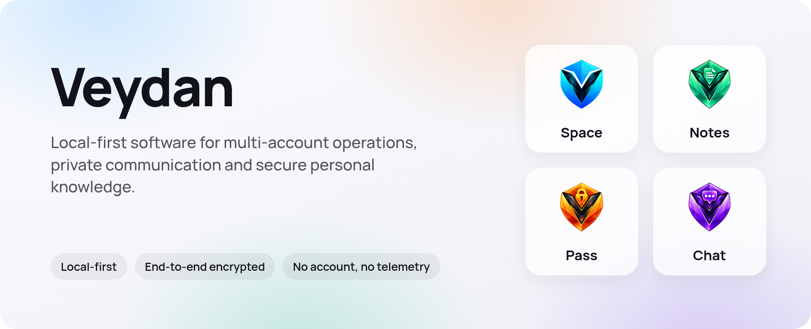
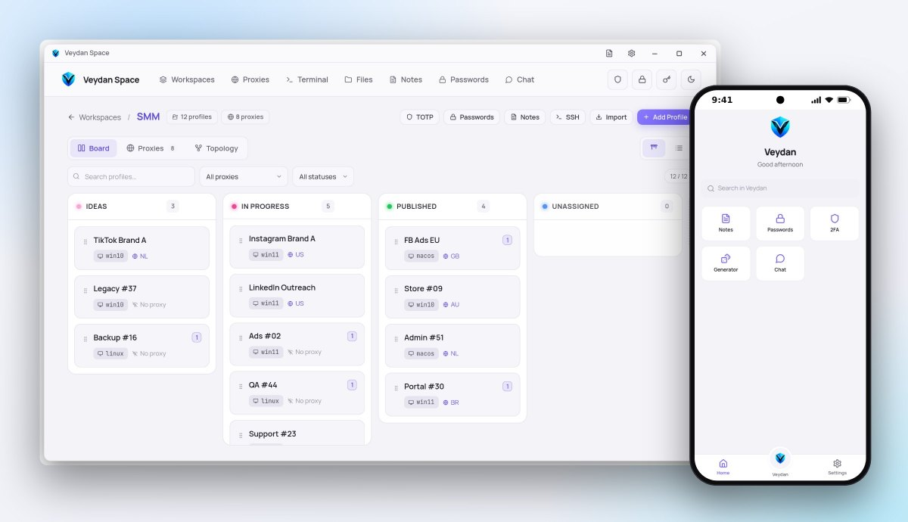
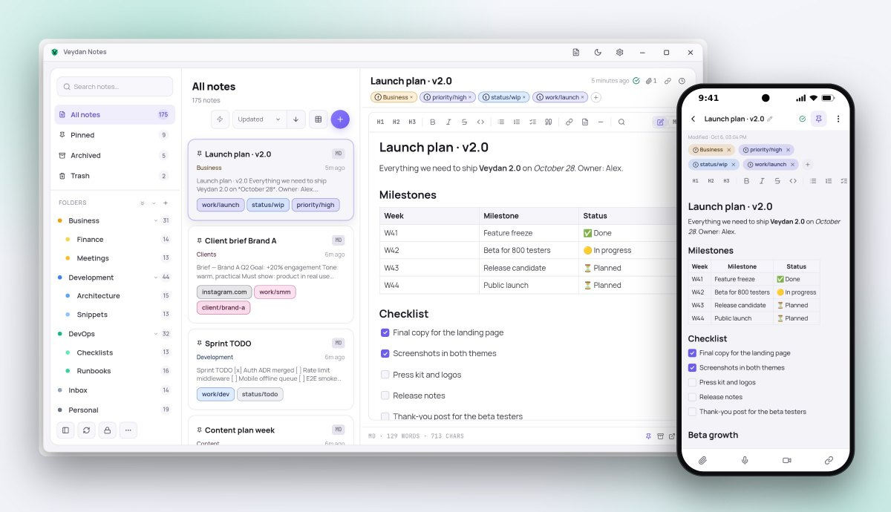
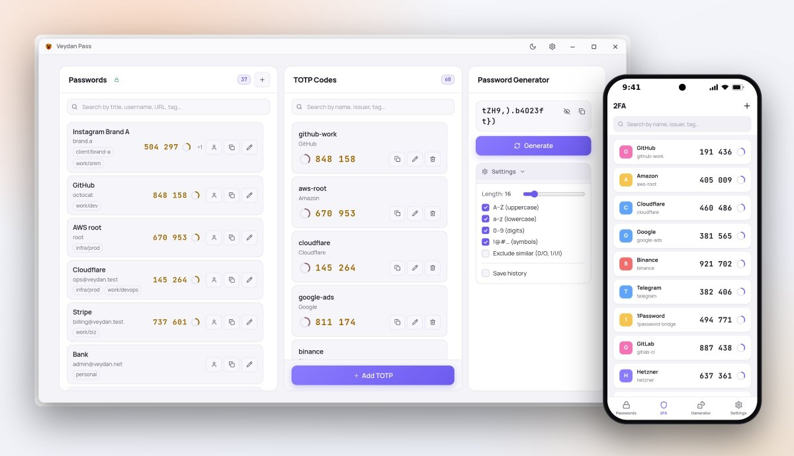
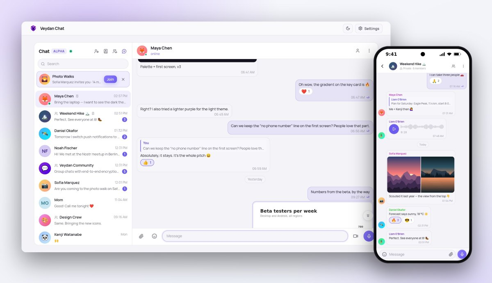

<picture>
  <source media="(prefers-color-scheme: dark)" srcset="images/banner-dark.png">
  
</picture>

  <a href="https://veydan.net">veydan.net</a> ·
  <a href="mailto:hello@veydan.net">hello@veydan.net</a>

We make desktop and mobile apps that keep your data **on your devices**.
No account with us, no telemetry, and sync that goes through storage **you**
choose — encrypted on the device before it leaves.

## Our apps

<table>
  <tr>
    <td width="50%" valign="top">
      <a href="https://github.com/veydanproject/Veydan-Space">
        <picture>
          <source media="(prefers-color-scheme: dark)" srcset="images/space-dark.jpg">
          
        </picture>
      </a>
      <h3><a href="https://github.com/veydanproject/Veydan-Space">Veydan Space</a></h3>
      One workspace for many accounts: isolated browser profiles, proxies,
      SSH and SFTP, notes, passwords, 2FA and chat, organised into workspaces.
        
      <a href="https://github.com/veydanproject/Veydan-Space/releases/latest"><b>Download</b></a>
    </td>
    <td width="50%" valign="top">
      <a href="https://github.com/veydanproject/Veydan-Notes">
        <picture>
          <source media="(prefers-color-scheme: dark)" srcset="images/notes-dark.jpg">
          
        </picture>
      </a>
      <h3><a href="https://github.com/veydanproject/Veydan-Notes">Veydan Notes</a></h3>
      Markdown notes that are plain files on your disk, with version history,
      tables, attachments and end-to-end encrypted sync.
        
      <a href="https://github.com/veydanproject/Veydan-Notes/releases/latest"><b>Download</b></a>
    </td>
  </tr>
  <tr>
    <td width="50%" valign="top">
      <a href="https://github.com/veydanproject/Veydan-Pass">
        <picture>
          <source media="(prefers-color-scheme: dark)" srcset="images/pass-dark.jpg">
          
        </picture>
      </a>
      <h3><a href="https://github.com/veydanproject/Veydan-Pass">Veydan Pass</a></h3>
      Your passwords. Your 2FA. Your vault. A local-first password manager
      and authenticator, synced through storage you control.
        
      <a href="https://github.com/veydanproject/Veydan-Pass/releases/latest"><b>Download</b></a>
    </td>
    <td width="50%" valign="top">
      <a href="https://github.com/veydanproject/Veydan-Chat">
        <picture>
          <source media="(prefers-color-scheme: dark)" srcset="images/chat-dark.jpg">
          
        </picture>
      </a>
      <h3><a href="https://github.com/veydanproject/Veydan-Chat">Veydan Chat</a></h3>
      End-to-end encrypted chat on Nostr. No phone number: your identity is a
      key only you hold. Groups, photos, voice and video messages.
        
      <a href="https://github.com/veydanproject/Veydan-Chat/releases/latest"><b>Download</b></a>
    </td>
  </tr>
</table>

Every app runs on **Windows, macOS, Linux and Android**.

## What we believe in

- **Local-first.** Your data lives on your devices and works offline. The
  cloud is optional, and it is yours.
- **Encryption before anything leaves.** Sync storage and servers only ever
  see ciphertext.
- **No accounts, no telemetry.** We do not know who uses our apps, and we
  like it that way.
- **Honest about limits.** Each README says exactly what is protected and what
  is not.

## Infrastructure

The servers behind Veydan Chat are open too:

- [**Veydan Link**](https://github.com/veydanproject/Veydan-Link) — bridges
  that carry Veydan traffic to people whose networks throttle or block it.
- [**Veydan Push**](https://github.com/veydanproject/Veydan-Push) — the push
  server that wakes your phone when a message arrives, without ever seeing
  its contents.

## Get in touch

Bug or idea? Open an issue in the repository of the app. Anything else —
[hello@veydan.net](mailto:hello@veydan.net).

---

© 2026 Veydan Project.
Developed by Rookbeam Technologies LLC, USA.
